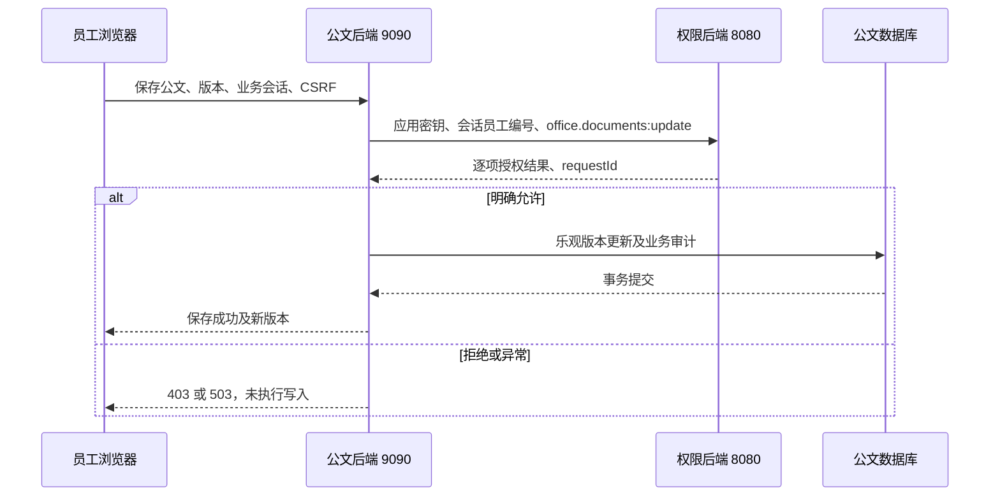

# 公文业务系统与权限服务设计

版本：0.2.0；日期：2026-10-21；状态：已实现，本机验证。验收证据见[接入验收记录](公文系统接入验收记录.md)。

## 1. 系统职责

权限平台为 Java 21 / Spring Boot / MyBatis / MySQL 服务，8080 端口，同时提供 Vue 管理界面。只有拥有 platform:access 的管理账号可以登录；管理会话绝对有效 1800 秒，不续期。普通员工不需要该平台账号密码。

独立公文系统为第二个 Java 21 / Spring Boot 服务，9090 端口，提供公文列表、正文编辑和保存。两套后端通过 HTTP 连接，不交叉访问数据库。公文后端从自己的会话取得员工编号，按代码中固定的业务动作确定权限，不接受浏览器自报角色。



鉴权允许只表示可尝试该业务动作。公文后端仍需验证正文、版本及业务规则，并在自身事务提交后返回成功。已通过鉴权的在途请求允许完成；撤权提交后开始的新鉴权使用新状态。

## 2. 身份与凭据边界

| 场景 | 身份来源 | 凭据 | 授权关系 |
| --- | --- | --- | --- |
| 管理平台 | 本地管理员账号 | BCrypt 密码、MUNI_SESSION、写请求 CSRF | account → user_role → MANAGEMENT role → permission |
| 公文验证页面 | 固定的 editor / reader 合成员工配置 | 独立 OFFICE_SESSION、写请求 CSRF | 不向浏览器发放应用密钥 |
| 公文后端调用权限服务 | 业务会话中的 employeeId | X-App-Key | employee → employee_role → BUSINESS role → permission |

本机合成身份选择仅用于演示系统接入，明确不构成真实员工身份认证。接口只允许两个预设 profile，不接受任意 employeeId。两个 profile 必须配置为不同的正整数员工编号，否则服务拒绝启动；员工实际启停与权限由 RBAC 在每次检查时判断。正式接入时应替换为业务登录、SSO 或可信身份源，在服务端建立员工映射；不应将任意员工编号输入框直接开放为登录。

管理角色与业务角色的 purpose 在创建后不可修改。管理账号只能分配管理角色，员工只能分配业务角色；权限归属也检查管理应用与业务应用边界。账号可选关联员工资料，每名员工至多关联一个平台账号；该关联不参与员工业务权限计算。

## 3. 服务端批量鉴权契约

`POST /api/authorization/check`；请求头 `X-App-Key`；不接受管理员 Cookie 替代应用凭据。请求体仅允许 employeeId、permissionCodes 两个字段：正整数员工编号、1–50 个去重的精确权限码。无通配符、角色参数或账号参数。

```json
{"employeeId":10002,"permissionCodes":["office.documents:read","office.documents:update"]}
```

示例编号以本机配置为准，新环境不可硬编码。成功响应包含 employeeId、按请求顺序返回的 results 和 requestId；每项包含 permissionCode、allowed、reason（ALLOWED / NO_PERMISSION / EMPLOYEE_UNAVAILABLE）。员工不存在或停用时所有项拒绝；未知权限码为 NO_PERMISSION。任何已知权限越过调用方应用范围时整批 403，不返回部分结果。

| 状态 | 含义与业务端处理 |
| --- | --- |
| 200 | 检查逐项 allowed；200 本身不代表获得权限 |
| 400 | 字段、数量、重复、格式无效；修正请求 |
| 401 | 应用密钥不存在、失效或停用；不得降级放行 |
| 403 | 跨应用范围、浏览器来源等整批拒绝 |
| 503 | 权限数据或鉴权依赖不可用；业务端不执行操作 |

应用密钥由本机配置脚本生成，格式为公开标识和随机 secret；MySQL 只保存 secret 的 SHA-256，公文后端在忽略的本机配置中保存明文。每个接入方绑定一个非管理应用；不授权读取其他应用。浏览器不能得到应用密钥。未开启 CORS；带 Origin 的外部批量调用拒绝。

鉴权过程采用短 REQUIRES_NEW / REPEATABLE_READ 只读事务，首次读取凭据建立本批快照，凭据、员工状态、角色和权限使用同一视图。无权限缓存，数据库查询超时限制为 2 秒。管理写事务仍为 READ COMMITTED，并持有 policy_lock 重新鉴权、校验版本及最后管理员保护。并发快照和撤权后新请求分别已有测试。

公文客户端连接超时 500ms、总请求超时 1500ms，不重试、不跟随重定向。校验响应员工、权限数量、顺序、布尔值、原因和 requestId；缺项、重复、格式错误及上游非 200 均转为 503。权限明确拒绝转为业务 403。

## 4. 公文接口与存储

独立契约：[documents.openapi.json](api/documents.openapi.json)。共 8 个操作：公开 GET health、GET profiles；POST mock-session；会话保护的 GET me、POST logout、GET permissions、GET documents、PUT documents/{id}，路径前缀均为 /office-api。写操作（身份选择除外）必须携带本会话的 CSRF。会话绝对有效 30 分钟，退出或进程重启后失效。

公文存储采用 H2 文件数据库 `.local/office-data/documents`，独立随机凭据、控制台关闭。该选择用于低成本本机验证，不改变权限服务的 MySQL 基线，也不要求额外 MySQL 管理授权。后续真实业务部署可独立迁移到 MySQL。

| 表 | 字段与职责 |
| --- | --- |
| office_document | id、title、content、version；两条明确标记的合成公文 |
| office_change | id、employee_id、document_id、request_id、created_at；成功写入审计 |

GET documents 先检查 read 权限。PUT 先检查 update 权限，验证 title（1–120 字符）、content（1–10000 字符）与整数版本，再按 id/version 条件更新并加一版本，写审计后提交。版本冲突返回 409，不覆盖其他人的变更。拒绝或鉴权异常均不进入写事务。首次启动只补充缺失的合成公文，不重置现有文本。

## 5. 本期边界与扩展

已完成直接员工授权、应用隔离、批量鉴权、管理员专用界面、公文读取与修改、撤权即时验证。未实现真实员工登录、SSO、跨设备会话存储、公文审批流、文件上传、数据行范围、角色继承、全量审计检索或性能达标验收。固定合成身份与本机 HTTP 仅适用于本次接入验证；正式接入前应先确定身份源、HTTPS 与应用密钥运维责任。
