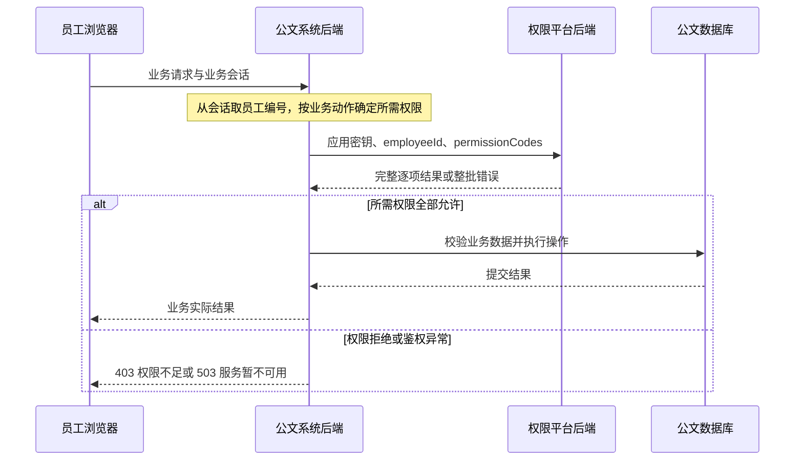

# 外部业务系统接入改造方案

版本：1.1；日期：2026-10-21。状态：方案已批准并按本版本完成主要实现。实施差异与验收见[公文业务系统设计](公文业务系统设计.md)及[接入验收记录](公文系统接入验收记录.md)。下文保留评审时的现状/目标对照，现状列指改造前。

本版在 1.0 基础上，将单权限候选请求改为“单员工、1–50 个权限码”的统一批量请求，并补充应用认证、逐项决策、批次一致性、业务端处理及验收规则。1.0 的单权限字段 `permissionCode` 尚未实现，本版直接以 `permissionCodes` 数组替代，不新增旧字段兼容接口。实施后移除旧演示操作并增加员工授权与批量鉴权，当前共 30 个 RBAC 操作。

参考 [CommonRBAC 接口设计 §2.7–2.8](https://github.com/qa22official/CommonRBAC/blob/312655f42d8f7601f96270a071607d985688510f/docs/04-接口设计.md)，固定参考版本为 `312655f`。借鉴其“业务后端提交目标用户与权限列表、中心返回逐项结果”的契约组织方式。员工模型、认证凭据、应用隔离、会话和一致性规则按本项目需求重新设计，不照搬其代码或性能承诺。

## 目标与职责

权限平台仅供具有管理权限的账号登录使用，保留固定 30 分钟会话、基础管理、角色权限配置及最后完整管理员保护。普通员工资料继续保留，业务角色直接分配给员工，员工无需建立权限平台登录账号或密码。

公文业务系统独立提供员工页面、业务身份上下文及公文操作。其后端从可信身份上下文取得员工 ID，在每次受保护操作前向权限平台申请鉴权；得到明确允许后，再执行自身业务。权限平台不执行公文修改，也不接受调用方自行声明的角色作为授权依据。

| 内容 | 当前实现 | 目标实现 |
| --- | --- | --- |
| 权限平台入口 | 管理入口与员工演示入口 | 仅管理员登录及管理界面 |
| 业务授权主体 | account → user_role → role | employee → employee_role → 业务角色 |
| 平台管理授权 | 管理账号的显式操作权限 | 继续使用管理账号及管理角色，保留保护约束 |
| 员工身份确认 | 权限平台本地账号登录 | 外部业务系统负责；首期采用明确标注的合成身份模拟 |
| 公文操作 | 权限平台内部演示读取 | 独立公文系统提供读取与修改 |
| 系统间连接 | 尚无专用接入凭据及鉴权接口 | 受应用凭据保护的服务端鉴权接口 |

## 调用流程与复杂度

推荐请求流程为“员工浏览器 → 公文系统后端 → 权限平台鉴权 → 公文系统后端执行 → 浏览器接收结果”。其中公文后端等待鉴权响应，获得允许后继续处理原请求；权限平台无需回调业务系统。



与原来在同一 Spring 服务内执行权限检查相比，该方案每次受保护操作增加一次后端 HTTP 调用；同一员工的多个权限检查可在一次请求中完成。调用会增加网络耗时和一个服务可用性依赖，但不要求引入网关、消息队列、服务注册中心或递归调用。首期继续使用现有 Spring 单体提供权限服务，公文系统采用第二个小型 Spring 工程。

公文后端仅通过固定鉴权客户端调用权限平台，不读取权限数据库；权限平台不访问公文数据库。公文系统的“修改成功”必须在自身业务事务提交后返回，不能将鉴权响应 `allowed=true` 当成修改已完成。

## 服务端接入与身份边界

| 身份 | 识别方式 | 权限边界 |
| --- | --- | --- |
| 平台管理员 | 原有本地凭据、MySQL 会话、Cookie 与 CSRF | 管理账号、员工授权、角色、资源及接入配置；固定 30 分钟不续期 |
| 业务系统后端 | 每个接入系统独立的应用密钥 | 仅调用批量鉴权接口，且仅查询所绑定业务应用的权限 |
| 操作员工 | 业务后端从自身可信身份上下文取得 employeeId | 由中心的员工角色关系计算业务权限，不依赖平台登录账号 |

应用密钥只证明调用的是哪个业务后端，不能证明哪个员工已经登录。业务后端不得直接采用浏览器请求体或自定义头中的 employeeId、角色或权限作为可信身份。每个业务接口所需权限码由其后端固定配置；浏览器不能将“修改”所需权限替换为“读取”来通过鉴权。

首期约定业务后端使用权限中心的 employee.id；存在不同工号或用户名时，由接入系统维护到中心 employeeId 的明确映射。姓名、表格行号不能作为身份关联键。中心只接受已映射的编号，不在每次鉴权时猜测人员关系。可信调用方仍能够声明该应用内的员工身份，因此员工认证正确性属于接入方责任；密钥不能解决业务后端失陷后的身份冒用问题。

管理员 Cookie 不得代替应用密钥调用外部鉴权接口，应用密钥也不能访问后台管理接口。首期不增加服务账号密码登录、JWT 签发、刷新令牌、SSO 或全量权限下载接口。

## 统一批量鉴权契约（候选）

### 请求与校验

接口候选为 `POST /api/authorization/check`。一个请求仅检查一个员工，提交 1–50 个明确操作权限码；单权限调用也使用长度为 1 的数组，不单独设置单查接口。以下契约尚未写入现有 OpenAPI，当前服务不可调用。

```http
POST /api/authorization/check
Content-Type: application/json
X-App-Key: <公文系统专用接入密钥>

{
  "employeeId": 1000,
  "permissionCodes": [
    "office.documents:read",
    "office.documents:update"
  ]
}
```

| 字段或规则 | 建议契约 |
| --- | --- |
| employeeId | 必填，正整数，按现有员工 BIGINT 标识处理；一次仅一个员工 |
| permissionCodes | 必填字符串数组，原始长度 1–50；不允许 null、重复项或非字符串项 |
| 权限编码 | 沿用“功能点稳定编码:操作编码”，不引入参考仓库的三段式新命名 |
| 长度与字符 | 功能点编码 2–100 位、操作编码 2–40 位；均以小写字母开头，其余为小写字母、数字、点、下划线或短横线；完整长度不超过 141 位 |
| 精确匹配 | 不接受 `*`、通配前缀、空字符串或首尾空格，不自动纠正拼写 |
| 额外字段 | 不接受 roles、roleIds、appCode、allOf、anyOf、allowed 或旧字段 permissionCode；作用域来自已认证应用，组合策略由业务后端固定定义 |
| 响应缓存 | 返回 Cache-Control: no-store；两端首期均不缓存授权结果 |

任意字段格式错误使整个请求返回 400，不输出部分判定，也不静默去重。单批超过 50 项时，由业务后端拆分；不同批次是独立鉴权时点，不承诺跨批次属于同一快照。原子业务操作原则上只提交其实际所需的少量权限，避免下载和缓存员工全部权限。

### 逐项决策响应

受理成功返回 HTTP 200，每个输入权限码恰好对应一个结果，顺序与输入一致。HTTP 200 表示鉴权查询正常完成，不表示每项权限都通过，更不表示业务已经执行。

```json
{
  "employeeId": 1000,
  "results": [
    {
      "permissionCode": "office.documents:read",
      "allowed": true,
      "reason": "ALLOWED"
    },
    {
      "permissionCode": "office.documents:update",
      "allowed": false,
      "reason": "NO_PERMISSION"
    }
  ],
  "requestId": "6d27447fa35b4fcb93a8406bf57e54f5"
}
```

| reason | allowed | 含义 |
| --- | --- | --- |
| ALLOWED | true | 员工、业务角色、权限和资源链有效，且存在匹配授权 |
| NO_PERMISSION | false | 无有效授权、角色或权限停用、资源链停用，或该编码未定义；不区分具体缺失路径 |
| EMPLOYEE_UNAVAILABLE | false | 员工不存在或已停用；全部输入项均拒绝，不对外区分不存在与停用 |

requestId 由权限平台为每次请求生成，用于关联日志，不是可复用的授权票据。响应不返回员工真实姓名、电话、角色列表、权限全集或数据库细节。首期不存在基于陈旧快照的成功响应，因此不设置 degraded 字段。

### 作用域与整批失败

应用凭据绑定现有 resource 的一个 APPLICATION 根节点。已定义权限通过 permission.resource_id 沿资源父链找到所属应用，与调用方绑定对象比较，不能仅凭权限码字符串前缀决定隔离。

已定义的权限中，只要存在平台管理权限或其他应用权限，整个批次返回 403，不返回任何逐项结果；混入外部权限的批次不能部分成功。格式合法但尚未定义的编码返回 NO_PERMISSION，不据此推断或授予任何应用权限。应用本身停用使其凭据无效，返回 401。

| HTTP | code 或响应 | 业务后端处理 |
| --- | --- | --- |
| 200 | 完整 results，允许与拒绝可以混合 | 校验响应和所需项后决定业务是否可执行 |
| 400 | INVALID_CHECK_REQUEST | 集成参数错误，不执行业务；记录并修复调用参数 |
| 401 | INVALID_APP_CREDENTIAL | 凭据缺失、无效、撤销、过期或接入应用停用；不使用管理员会话重试 |
| 403 | APPLICATION_SCOPE_DENIED | 请求包含平台管理或已定义的其他应用权限；整批失败 |
| 503 | AUTHORIZATION_UNAVAILABLE | 数据库或鉴权依赖不可用；整批失败，不继续业务 |
| 500 | INTERNAL_ERROR | 未预期错误；整批失败，不继续业务 |

非 200 错误响应沿用现有 code、message 风格，仅在新增接口中补充 requestId；例如 `{"code":"APPLICATION_SCOPE_DENIED","message":"请求超出接入应用范围","requestId":"6d27447fa35b4fcb93a8406bf57e54f5"}`。不统一改写现有管理 API，不照搬另一项目的数字错误码或响应包装。

业务后端应核对 HTTP 状态、employeeId、输入输出权限码的一一对应、allowed 的布尔类型及 reason 的合法组合。缺项、重复项、多余项、员工不匹配或无法解析均按服务异常停止操作；新增的未识别字段可以忽略，但不得从中推断允许。接口不得因中途异常返回已完成的部分结果。

## 业务后端如何使用结果

菜单、按钮展示可以一次查询多个候选权限，但只是展示提示。执行实际读取或修改时必须重新鉴权；页面加载时的成功不能作为稍后写操作的凭证。

| 场景 | 业务端规则 |
| --- | --- |
| 展示读取和修改按钮 | 分别消费 read、update 的判定，不因其中一项允许而全部开放 |
| 执行修改公文 | 后端固定要求 office.documents:update，鉴权通过后再进入公文写事务 |
| 一个操作确实要求多项权限 | 业务后端固定定义 ALL 规则，所需项全部允许才执行；不由请求方选择策略 |
| 不同功能中的替代权限 | 首期不设计通用 ANY 表达式；如有实际需求再单独明确，避免前端任意组合 |
| 收到有效拒绝结果 | 业务系统向员工返回 403“权限不足”，公文数据和版本均不改变 |
| 鉴权服务异常或响应不完整 | 业务系统向员工返回 503“鉴权服务暂不可用”，不执行操作 |

业务数据本身的存在性、归属、版本冲突与数据范围由公文后端继续校验；拥有修改功能权限不表示可以修改任意组织的全部公文。首期仅验证合成数据上的功能权限，不宣称已实现生产数据范围。业务“修改成功”须在公文数据库事务提交后返回。

调用超时集中配置，首期建议总等待预算 1–2 秒，实际运行后调整，不作为 30ms 性能承诺。首期不自动重试；尤其不能因鉴权超时而自动重放公文写请求，也不能在 401、403 时循环请求或退回匿名访问。

## 批次一致性与凭据生命周期

### 同批使用一致授权视图

服务端一次计算该员工在调用应用中的有效权限集合，再匹配本批各权限，不逐项重复查询。该批应用与凭据状态、员工状态、授权和资源路径在同一短只读事务的一致视图内读取，避免两项结果分别读取到管理员修改前后的配置。

候选实现为仅在该鉴权过程开启新的 REPEATABLE READ 只读事务，以第一次一致性读取作为本次鉴权开始时点；不继承先前请求的视图，也不修改现有管理写事务的 READ COMMITTED 规则。管理员提交后才开始首次读取的新批次使用新配置；已开始鉴权的批次允许按其一致视图完成，沿用在途请求规则。事务仅覆盖鉴权读取和结果构造，不跨越 HTTP 返回或公文业务执行，不获取管理写策略锁。

读库或结果构造失败时整批失败，不以旧数据补全。多批次以及“鉴权后执行业务”之间不建立跨系统事务；本方案不保证已通过鉴权的请求被后续撤权强制中断。

### 每个系统独立凭据

每个接入系统建立独立 integration_client，绑定一个业务应用，另以 integration_credential 管理密钥。密钥只向初始化人员展示一次，业务后端保存在受忽略的本机配置；中心只保存摘要、标识、状态及可选到期时刻，不保存可回读明文。

密钥可采用公开凭据标识与至少 32 字节安全随机秘密的组合，通过 X-App-Key 请求头传递。平台按标识定位并校验摘要，不放入 URL、浏览器构建产物或日志。首期以配置工具创建和撤销接入对象，不额外开发完整的接入管理页面；日后可以复用同一模型扩展后台。

轮换顺序为“创建新密钥 → 更新业务后端配置并验证 → 撤销旧密钥”；短期允许同一接入系统两枚有效密钥并存，撤销后新鉴权立即读取新状态。正式部署须使用 HTTPS，首期仅在本机回环地址验证。这里借鉴的是服务端信任边界，不引入机器 JWT 续期协议。

### 最小日志与可追踪性

鉴权服务记录 requestId、接入方标识、员工编号、权限码、逐项决策或整批错误、耗时；不记录应用密钥、Cookie、密码或真实员工资料。首期使用结构化运行日志，不将每次纯读判定写入管理变更表。公文系统另行记录业务是否实际执行、目标公文和结果，并关联 requestId。权限查询日志不能代替业务操作审计，存储时长和生产审计要求在部署前另行确定。

服务端每次校验并在不确定时停止操作的设计依据参见 [OWASP 授权检查建议](https://cheatsheetseries.owasp.org/cheatsheets/Authorization_Cheat_Sheet.html)；接口凭据参见 [OWASP REST 安全建议](https://cheatsheetseries.owasp.org/cheatsheets/REST_Security_Cheat_Sheet.html)。

## 数据与现有代码影响

| 范围 | 计划修改 | 可复用部分 |
| --- | --- | --- |
| 数据库 | 新增 employee_role、integration_client、integration_credential；新增员工授权版本/有效状态与角色用途字段 | employee、organization、role、permission、resource、审计和版本化迁移机制 |
| 权限计算 | 新增员工业务权限计算、批量匹配、应用范围及整批一致性校验；同批只计算一次有效集合 | 权限并集、资源祖先有效性、参数绑定、无缓存读取 |
| HTTP 边界 | 为独立鉴权路径建立应用身份校验；其余管理路径继续会话及 CSRF 校验 | SecurityGate、SessionProcesses、错误响应规范 |
| 管理功能 | 新增员工角色分配与员工有效权限查询；限制业务角色不能获得平台管理权限 | 授权替换、版本冲突、事务及 policy_lock、角色权限配置界面 |
| 前端 | 移除员工与演示路由、入口选择；管理账号登录后进入工作台 | Vue 布局、基础管理页、筛选及授权变更预览 |
| 公文系统 | 新建独立前后端与数据库配置、少量公文数据、读取/修改接口；集中封装批量鉴权客户端及严格响应校验 | Java/Spring 和 Vue 技术栈与工程规范 |
| 文档与工具 | 更新需求、DFD、ER、字典、OpenAPI、Apifox、初始化/演练/打包工具及指南 | 已有文档目录、构建与验证方法 |

当前 `PermissionProcesses.effective(accountId)` 以账号为起点，`require` 还含演示权限前缀判断；改造时必须分别表达管理鉴权与员工业务鉴权，不能只添加一个控制器后复用全部旧判断。当前 `SecurityGate` 默认要求会话，外部鉴权路径必须显式建立另一套认证分支，不能简单放行匿名请求。

管理员仍须通过有效管理角色获得权限，不设置永久超级管理员绕过。具有管理员账号的自然人也可以拥有员工记录，但管理授权与业务授权互不推导。员工禁用后，其业务权限应失效；该状态需通过新增迁移明确建立。

候选模型补充如下，具体列名及 SQL 在下一步数据库设计中落实：

| 对象 | 最小约束 |
| --- | --- |
| employee_role | employee_id 与 role_id 联合唯一并建立外键；只接受业务角色；授权替换使用员工独立 grants_version |
| employee | 增加 enabled 和 grants_version，不以是否具备平台账号决定可授权性 |
| role | 增加管理/业务用途，业务角色不能关联管理权限，管理员账号角色关系不能转作业务身份 |
| integration_client | 绑定现有 APPLICATION 资源节点，具有独立稳定标识和启停状态；首期一个客户端仅绑定一个业务应用 |
| integration_credential | 关联接入方，保存唯一公开标识、密钥摘要、状态及有效期，不保存明文；支持轮换期间多个凭据 |

同一业务角色可以拥有多个业务应用权限，但一次外部鉴权只检查调用方应用下的请求项；应用范围由服务端验证，不能通过角色组合扩大查询范围。首期继续使用外键、版本约束和现有管理写保护，不采用参考仓库“不建应用关系、仅凭前缀约定”的方案。

## 数据迁移与兼容处理

1. 改造前记录源码基线、开发库快照及接口导出；现有已应用迁移保持原样，后续变更追加新迁移。
2. 建立员工授权关系和应用接入配置，保留既有账号、来源资料与审计历史，不批量删除。
3. 仅迁移已明确关联员工的业务授权；管理角色不得迁入员工关系，混合权限角色需先拆分审核。
4. `demo_user` 已关联合成员工，可用于候选迁移验证；`flow_user` 无员工关联，不自动猜测对应员工，采用新增合成测试员工重新建立验收数据。
5. 旧演示账号在入口切换时停用并回收会话；旧业务授权在兼容阶段不得继续作为员工权限的另一条来源。管理员会话、角色和保护规则单独回归。
6. 验证管理员可登录、员工无需平台账号、原始资料与历史记录未丢失后，再交付新版操作指南。迁移失败保留旧版本运行依据，恢复只在确认目标环境后执行。

## 首期公文系统范围

公文系统建议使用本机独立端口（候选 9090），独立工程和业务库；权限平台继续使用 8080。业务系统使用单独 Cookie 名称及配置，不与管理员会话共用。两者无需共享数据库表或浏览器跨域凭据。

首期仅提供合成公文列表、详情与标题/内容修改，以及明确标注的合成员工身份模拟。模拟入口仅用于本机对接验证，服务器只能选择预设合成员工并建立业务会话，后续请求从该会话取得员工 ID；不得以浏览器任意传入的 employeeId 作为可信身份。真实统一登录或员工认证属于后续接入事项，不在首期宣称完成。

首期不扩展审批流、附件、组织数据范围或 18 套业务系统。文档读取和修改分别定义权限，业务系统在服务端同时保护查询与更新；不得只隐藏按钮。

## 实施顺序、估算与验收

建议依次完成：详细需求与契约 → 新增迁移及员工授权 → 应用接入认证与鉴权接口 → 管理界面调整 → 独立公文系统 → 联调、文档与回归。每一步形成可检查成果，再进入下一步。

工作量判断为中等规模：核心算法可复用，主要工作是授权主体、可信边界、存量迁移及跨系统回归。初步预算约 24–40 人时，按单人每天 6–8 小时约 3–7 个工作日；该数字仅用于范围评估，不是交付承诺。若加入真实企业单点登录、审批流或生产部署，应重新估算。

| 验收场景 | 通过标准 |
| --- | --- |
| 管理入口与会话 | 普通演示入口不可达；无管理权限不能登录后台；管理员 1799/1800/1801 秒边界、CSRF 与最后管理员保护仍通过 |
| 员工直接授权 | 员工无平台账号，仍可通过角色获得读取/修改权限；多角色取并集，关系更新有版本冲突和事务回滚验证 |
| 跨系统授权回收 | 同一业务员工会话，先修改成功；管理员回收后下一次鉴权拒绝，公文内容与版本均未改变；恢复授权后再次成功 |
| 失效与作用域 | 员工、角色、权限、资源祖先及调用应用停用均拒绝；业务角色不能获得管理权限 |
| 单项与混合结果 | 长度为 1 和多项请求均可用；read 允许、update 拒绝时结果完整且顺序正确，公文修改仍被拒绝 |
| 请求边界 | 1、50 项受理；0、51 项、重复项、null、通配符、非法编码、旧字段和多员工请求整批返回 400 |
| 调用方边界 | 无效、撤销、过期密钥均返回 401；仅管理员 Cookie 不能调用；应用密钥不能调用管理 API；业务后端忽略浏览器自报员工身份 |
| 应用范围 | 一批混入已定义的其他应用或管理权限，整批 403 且无 results；未定义合法权限为 NO_PERMISSION |
| 员工状态 | 员工不存在或停用时所有输入项均为 EMPLOYEE_UNAVAILABLE，不泄露不同人员状态 |
| 批次一致性 | 使用可控并发顺序在批次读取期间修改授权，同批结果保持一致；变更提交后新开始读取的批次使用新状态 |
| 服务故障 | 超时、断连、数据库异常、缺项/重复/多余结果或身份不匹配均不执行公文修改，员工收到明确服务异常反馈 |
| 凭据轮换 | 新旧凭据重叠时可用；撤销旧密钥后新批次拒绝旧密钥，新密钥可用；日志无密钥明文 |
| 数据与契约 | 来源资料、旧审计保留；新增迁移在独立测试库通过；OpenAPI 与 Apifox 同步；新安装和端到端测试记录独立保存 |

权限变更提交后开始的鉴权使用新状态，已完成鉴权的在途业务请求允许完成，沿用既定规则；首期不引入权限缓存。实际接口数量、表字段及文件清单在详细设计完成后确定。

## 本次借鉴范围与后续交付

| 决策 | 处理方式 |
| --- | --- |
| 采用 | 业务后端持可信调用凭据；目标员工与调用应用分开；1–50 项批量查询；逐项 allowed/reason；中心只回答判定 |
| 按本项目调整 | userId 改为 employeeId；沿用现有权限编码及 code/message 错误风格；由数据库资源归属校验应用边界 |
| 保持既定规则 | 管理员 30 分钟固定会话；员工无需平台凭据；授权提交后新鉴权使用新状态；故障时停止操作 |
| 首期暂不引入 | 服务账号 JWT 登录/刷新、权限快照、Redis 广播、陈旧数据继续放行、通配权限、SSO、全量权限下载、多员工同批查询 |

下一步输出新增迁移设计、字段字典与 ER 差异，以及独立的“拟实现接口”OpenAPI 草稿和验证用例；其状态应与现有 26 个已实现操作区分。随后再实施员工授权和应用认证，验证批量接口后建立公文系统。实现并联调通过后，才更新当前权威 OpenAPI、Apifox、安装指南及演示记录。

本次仅形成 1.1 方案并同步需求与计划中的候选契约，不执行迁移、创建密钥、停用旧账号或启动新服务。文中边界用例是后续验收要求，不是本次已通过的接口测试。

## 实施状态补充

2026-10-22：上述首期范围已完成；当前权威实现见《公文业务系统设计》和《公文系统接入验收记录》。公文存储采用独立 H2 文件库，便于本机运行；权限主库继续为 MySQL。接入凭据配置采用受控本机脚本，未增加浏览器凭据管理页面。真实员工登录、SSO、数据行范围和性能目标均维持后续事项。
