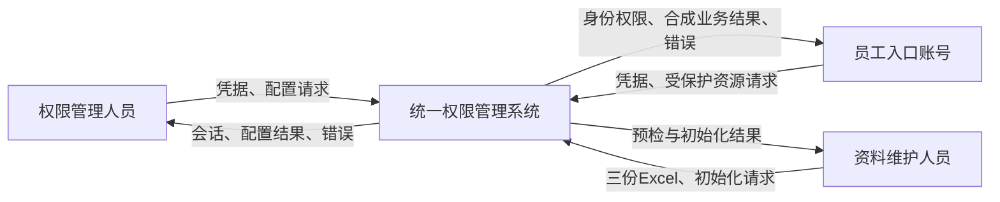
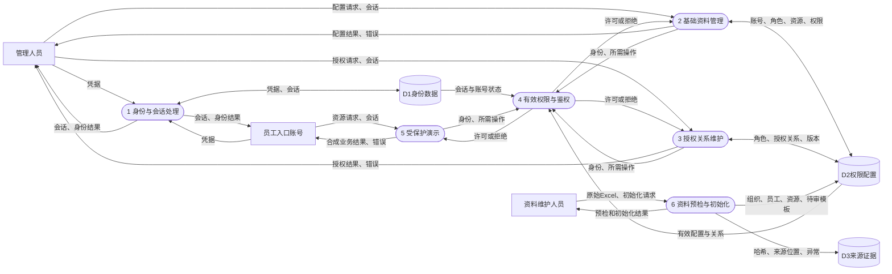
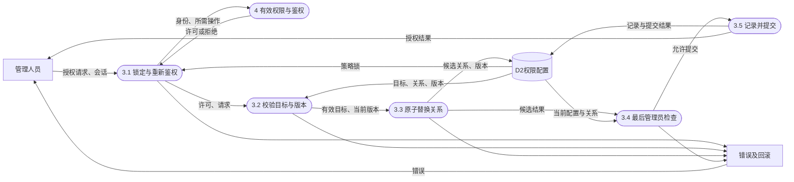
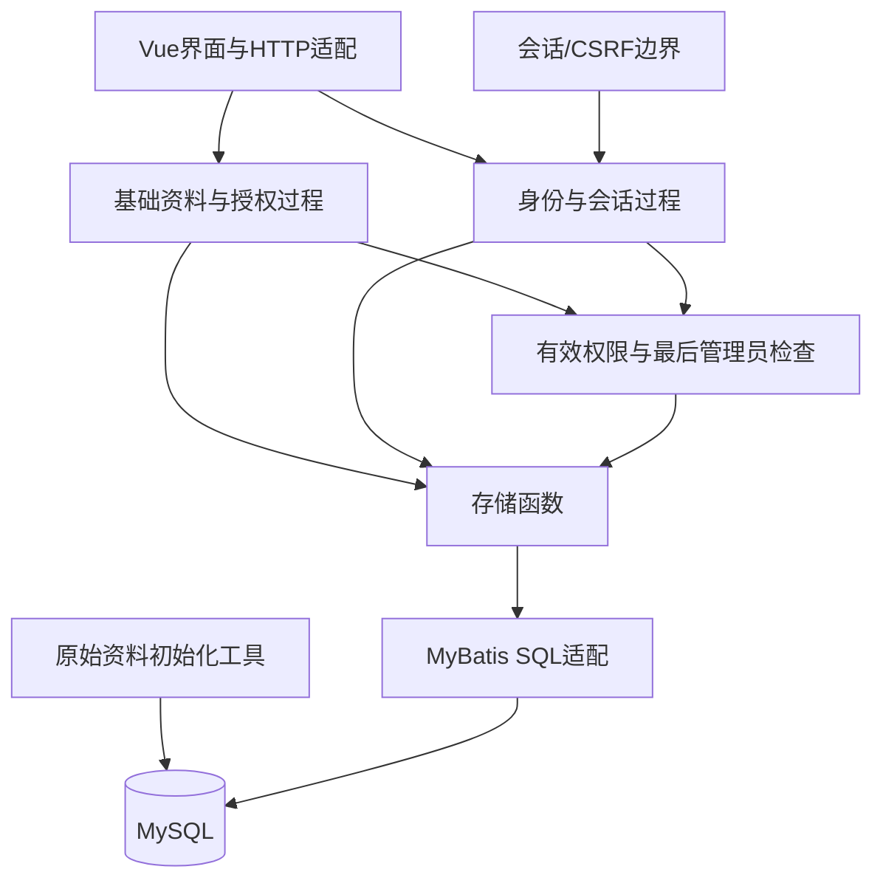

# 开发设计说明书

本轮实现为 Java 21、Spring Boot 3.5.16、MyBatis 3.0.5、MySQL 8.4.8、Vue 3.5.44、TypeScript 5.9.3、Tailwind 4.3.3 与 Vite 7.3.7 的模块化单体。版本已实际下载与构建，未采用微服务、Redis、JWT 或规则引擎。兼容依据参考 [Spring Boot 3.5 系统要求](https://docs.spring.io/spring-boot/3.5/system-requirements.html)与 [Vite 入门要求](https://vite.dev/guide/)；最终可运行性以本机测试记录为准。

## 系统边界与上下文图

外部实体为权限管理人员、使用员工入口的账号，以及提供原始文件的资料维护人员。系统维护权限配置、计算有效权限、控制演示操作。MySQL 为系统内部数据存储；Navicat 为开发管理工具，Apifox 为接口设计/调试工具，都不是业务身份源。



## 一级数据流图



数据流平衡：上下文的“凭据”进入加工1；“配置请求”进入2/3，结果与错误返回管理人员；员工“资源请求”进入5，结果返回员工；“原始文件/初始化请求”进入6，预检/初始化结果返回资料人员。内部鉴权与存储流只在一级图出现，没有新增未解释的外部输入输出。会话随配置或资源请求传递并在1/4的契约中校验，未把前端自报身份当数据流可信来源。

授权维护的下层分解：



本图保留加工3与管理人员的请求/结果、与加工4的鉴权请求/判定以及 D2 读写。会话先按边界过程转换为可信身份，最后管理员检查在同一事务内完成；异常回滚不会把候选关系作为成功结果返回。D2 的变更日志也在同一存储边界内，未新增外部请求。

## 数据字典与关键加工

| 数据流 | 内容与校验 | 生产者/消费者 |
| --- | --- | --- |
| 凭据 | username、password；长度及 BCrypt 比对；不进入日志 | 登录页 → SessionProcesses |
| 会话身份 | 随机 Cookie 的哈希、账号 ID、CSRF、固定到期时刻 | SessionProcesses → SecurityGate/HTTP过程 |
| 资料变更 | 目标 ID、字段、version；规范编码与引用校验 | 管理界面 → ManagementProcesses |
| 授权变更 | 目标 ID、不重复的 ids、grantsVersion | 授权界面 → replaceGrants |
| 有效权限 | 当前有效状态下去重的具体操作编码集合 | PermissionProcesses → API/员工页 |
| 资料预检结果 | 哈希、实际行数、合并锚点、异常位置及聚合计数 | audit_sources/import_sources → 初始化流程 |

字段级持久化字典见《数据库字段字典》，HTTP 字段级字典见 OpenAPI schemas。关键加工伪代码：

```text
配置变更(actor, expectedVersion, payload):
    begin READ COMMITTED transaction
    lock policy_lock(1)
    recalculate actor permissions; reject if missing required operation
    validate payload and referenced rows
    update owner where version = expectedVersion; if 0 rows then conflict
    apply metadata or replace the explicit relationship set
    if no enabled/unlocked account still owns the complete management set: reject
    insert successful change log
    commit; otherwise rollback all writes

有效权限(account):
    if disabled or locked: return empty
    find enabled resource roots and recursively enabled descendants
    join account -> user_role -> enabled role -> role_permission -> enabled permission
    restrict permissions to enabled resource paths
    return distinct operation codes

会话校验(token, now):
    hash token; load session and current account state
    reject if missing, disabled, locked, or now >= expiresAt
    for writes, compare CSRF without data-dependent string comparison
    never update expiresAt during requests
```

## 模块结构与面向功能组织



Java 类用于容纳过程与框架注入，不以此宣称已经完成面向对象路线。HTTP 适配主要转发请求；基础管理、授权替换、有效权限计算、身份会话按功能分解。SQL 只由内部固定语句构造，值绑定为参数；动态表名只来自内部二选一常量，不来自请求。

内聚：PermissionProcesses 聚焦权限集合及保护约束，SessionProcesses 聚焦身份和绝对会话；初始化工具独立于运行时 HTTP。耦合：各过程仅依赖 Store 的数据读写函数及明确输入输出；HTTP 不直接拼业务授权 SQL。ManagementProcesses 目前合并了几个相近的基础管理过程，适合首检小规模；继续扩展时可按资源/账号等功能拆分，不能把类数量作为设计质量指标。

## 安全与实现限制

登录使用 BCrypt，32 字节随机会话标记只在 Cookie 明文出现，数据库存 SHA-256；CSRF 由会话生成并由前端写请求回传。Cookie 为 HttpOnly、SameSite=Strict，当前仅本机 HTTP，部署 HTTPS 时必须启用 Secure 并审定可信来源。登录错误统一反馈；同一来源/用户名五分钟内连续五次失败后限流，不限制管理员人数、设备数或空闲时间。

首个管理员只由本机配置初始化，不存在永久超级用户绕过。用户本轮明确指定 `1234` 作为本机管理员、演示和测试密码；实际账号说明放在被忽略的 `.local/测试账号.md`。此前“不使用公开默认密码”的规则据此调整为“无程序内置默认密码，当前本机密码由用户指定”；正式部署应重新设置。

本轮不实现 RBAC1/RBAC2、数据范围、临时账号到期、增量导入和通用导入页面；不宣称万级并发或 30ms 指标已达标。开发工具、接口导入、执行测试和界面核验分别记录真实状态，见《测试与验收》和《运行与使用》。
