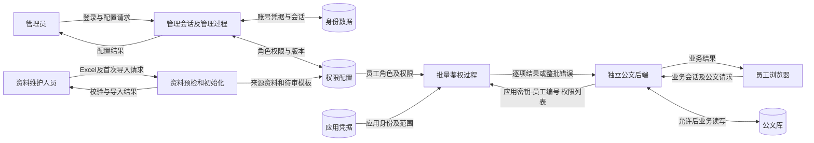
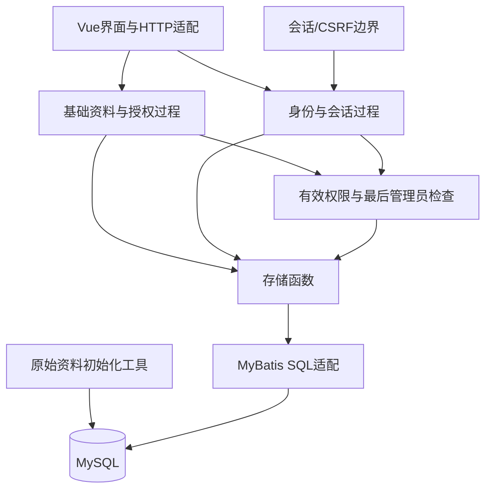

# 开发设计说明书

> 适用版本：0.2.0；管理权限与员工业务权限分离，独立公文接入已实现。下文原资料导入及管理过程设计继续适用；原演示过程由独立公文后端替代。

权限平台采用 Java 21、Spring Boot 3.5.16、MyBatis 3.0.5、MySQL 8.4.8、Vue 3.5.44、TypeScript 5.9.3、Tailwind 4.3.3 与 Vite 7.3.7 的模块化单体，独立公文系统采用第二个 Spring 服务。版本已实际下载与构建，未采用微服务、Redis、JWT 或规则引擎。兼容依据参考 [Spring Boot 3.5 系统要求](https://docs.spring.io/spring-boot/3.5/system-requirements.html)与 [Vite 入门要求](https://vite.dev/guide/)；最终可运行性以本机测试记录为准。

## 系统边界与数据流

权限平台的外部实体为管理员、可信业务后端及资料维护人员。普通员工只进入业务系统，由业务后端携带员工编号请求 RBAC；公文业务数据库位于独立服务边界。Navicat 和 Apifox 均为开发工具。



管理会话过程只为具备 platform:access 的账号创建会话。管理写按策略锁、重新鉴权、版本检查、原子关系替换、最后管理员检查、审计提交的顺序执行；任意失败回滚。员工授权使用相同写过程约束，但目标为 employee_role。

外部鉴权先验证应用凭据及应用状态，再校验严格批量请求和应用范围，随后计算员工业务权限并返回完整结果。该批次使用短 REPEATABLE_READ 同一快照，无缓存；管理写为 READ COMMITTED。撤权提交后才开始的新鉴权读取新状态；已通过检查的在途业务允许完成。

公文后端从独立会话取得 employeeId，业务代码确定权限码。RBAC 不接收浏览器声明的角色，也不执行公文更新。公文后端只在明确允许后进入自身业务事务，异常则 403/503 并停止。详细时序和存储见[公文业务系统设计](公文业务系统设计.md)。

## 数据字典与关键加工

| 数据流 | 内容与校验 | 生产者/消费者 |
| --- | --- | --- |
| 凭据 | username、password；长度及 BCrypt 比对；不进入日志 | 登录页 → SessionProcesses |
| 会话身份 | 随机 Cookie 的哈希、账号 ID、CSRF、固定到期时刻 | SessionProcesses → SecurityGate/HTTP过程 |
| 资料变更 | 目标 ID、字段、version；规范编码与引用校验 | 管理界面 → ManagementProcesses |
| 授权变更 | 目标 ID、不重复的 ids、grantsVersion | 授权界面 → replaceGrants |
| 有效权限 | 当前有效状态下去重的具体操作编码集合 | PermissionProcesses / AuthorizationProcesses → 管理 API / 业务后端 |
| 资料预检结果 | 哈希、实际行数、合并锚点、异常位置及聚合计数 | audit_sources/import_sources → 初始化流程 |

字段级持久化字典见《数据库字段字典》，HTTP 字段级字典见 OpenAPI schemas。关键加工伪代码：

```text
配置变更(actor, expectedVersion, payload):
    begin READ COMMITTED transaction
    lock policy_lock(1)
    recalculate actor permissions; reject if missing required operation
    validate payload and referenced rows
    update owner where version = expectedVersion; if 0 rows then conflict
    apply metadata or replace the explicit relationship set
    if no enabled/unlocked account still owns the complete management set: reject
    insert successful change log
    commit; otherwise rollback all writes

有效权限(account):
    if disabled or locked: return empty
    find enabled resource roots and recursively enabled descendants
    join account -> user_role -> enabled MANAGEMENT role -> role_permission -> enabled permission
    restrict to management application and require platform:access
    restrict permissions to enabled resource paths
    return distinct operation codes

会话校验(token, now):
    hash token; load session and current account state
    reject if missing, disabled, locked, or now >= expiresAt
    for writes, compare CSRF without data-dependent string comparison
    never update expiresAt during requests
```

## 模块结构与面向功能组织



Java 类用于容纳过程与框架注入，不以此宣称已经完成面向对象路线。HTTP 适配主要转发请求；基础管理、授权替换、有效权限计算、身份会话按功能分解。SQL 只由内部固定语句构造，值绑定为参数；动态表名只来自内部二选一常量，不来自请求。

内聚：PermissionProcesses 聚焦权限集合及保护约束，SessionProcesses 聚焦身份和绝对会话；初始化工具独立于运行时 HTTP。耦合：各过程仅依赖 Store 的数据读写函数及明确输入输出；HTTP 不直接拼业务授权 SQL。ManagementProcesses 目前合并了几个相近的基础管理过程，适合首检小规模；继续扩展时可按资源/账号等功能拆分，不能把类数量作为设计质量指标。

## 安全与实现限制

登录使用 BCrypt，32 字节随机会话标记只在 Cookie 明文出现，数据库存 SHA-256；CSRF 由会话生成并由前端写请求回传。Cookie 为 HttpOnly、SameSite=Strict，当前仅本机 HTTP，部署 HTTPS 时必须启用 Secure 并审定可信来源。登录错误统一反馈；同一来源/用户名五分钟内连续五次失败后限流，不限制管理员人数、设备数或空闲时间。

首个管理员只由本机配置初始化，不存在永久超级用户绕过。本机管理员测试密码为 `1234`；普通员工无平台密码，旧演示账号已停用，当前清单见《账号员工与角色说明》。程序不内置默认密码，新环境通过本机初始化设置凭据；正式部署需另行制定密码策略。

当前版本未实现 RBAC1/RBAC2、数据范围、临时账号到期、增量导入和通用导入页面；不宣称万级并发或 30ms 指标已达标。开发工具、接口导入、执行测试和界面核验分别记录真实状态，见《测试与验收》和《运行与使用》。
