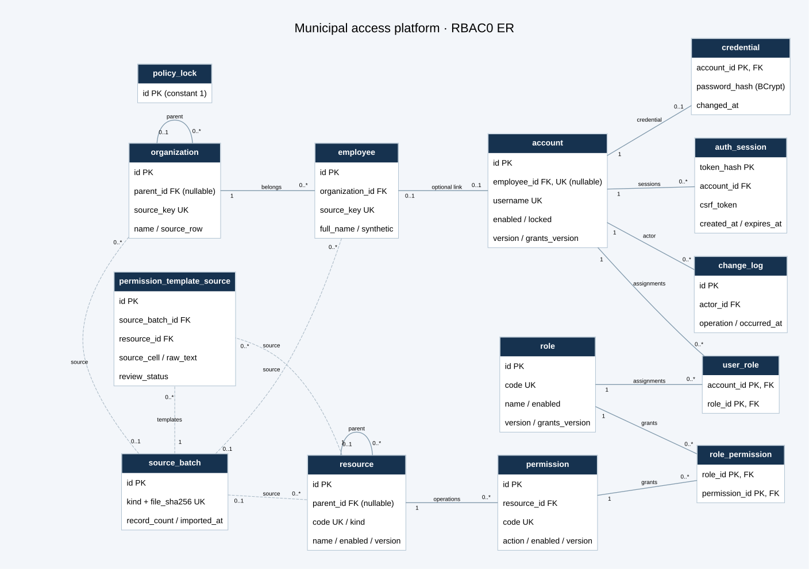

# 数据库设计与 ER

实现基线：MySQL 8.4.8、InnoDB、utf8mb4；14 张业务表，另有 Flyway 自身的 schema history 表。字段定义见《数据库字段字典》，实际约束以版本化 SQL 为准。开发库和测试库分别为 `municipal_access_ooad_dev`、`municipal_access_ooad_test`。

完整基数与来源关系同时保留在 `数据库ER.mmd` 及 SVG 中；SVG/PNG 使用 Graphviz 自动布局，端点数字表示基数，虚线表示来源追踪。policy_lock 是用于并发控制的单行技术表，没有业务外键。

## 概念模型与基数

- 组织有可空父组织，根节点无父组织；一个组织可拥有多个员工，每个员工属于一个组织。
- 员工与账号均最多关联一个对象；账号 employee_id 可空，UNIQUE 允许多个不关联员工的账号。
- 用户与角色多对多，由 user_role 表示；角色与操作权限多对多，由 role_permission 表示。
- 应用、模块、功能点统一放入资源目录；只有功能点可配置操作权限。权限编码为资源稳定代码与操作代码拼接，例如 demo.documents:read。
- 每个账号最多一条凭据记录，可有多个固定有效期会话。不设置设备数量或管理员人数上限。
- 原始来源批次关联组织、员工、资源及候选角色模板。原始模板与真实授权关系分开，不自动导出授权。

| 表 | 职责及主要规则 |
| --- | --- |
| organization | 组织节点与父子关系；source_key 本批唯一；source_batch_id/source_row 追踪原件 |
| employee | 独立员工资料、组织、岗位、电话；synthetic 区分合成样例；不自动生成网页账号 |
| account | 用户名、展示名、员工关联、启用/锁定；version 和 grants_version 分别控制资料及角色配置 |
| role | 角色稳定代码、名称、说明、状态；无继承、互斥或人数限制 |
| resource | 应用/模块/功能点；稳定代码、父节点、类型和状态；V3 增加原始功能说明 description |
| permission | 功能点上的操作、稳定编码和状态；resource_id/action 联合唯一 |
| user_role | account_id/role_id 联合主键；反向索引便于按角色查关系 |
| role_permission | role_id/permission_id 联合主键；反向索引便于按权限查关系 |
| credential | 账号一对一凭据；只保存 BCrypt 哈希，不保存明文密码 |
| auth_session | 只保存随机会话标记的 SHA-256；记录 CSRF、创建与绝对到期时间 |
| policy_lock | 固定一行，用于串行化少量管理员配置写入及最后管理员保护 |
| change_log | 提交成功的管理操作及操作者；不保存请求正文、密码或原始个人资料 |
| source_batch | 文件哈希、来源类型、记录数、导入时间；类型/哈希联合唯一 |
| permission_template_source | 原始角色列文本与单元格，默认 PENDING；真实空白存 NULL；不等价于 role_permission |

## 约束和索引

所有关联使用外键，未配置级联删除。账号用户名、角色代码、资源代码、权限代码及来源键有唯一约束；账号 employee_id 唯一，落实最多一对一。用户名和权限代码使用 ascii_bin，写入过程限制小写字符，避免大小写隐式合并。

角色/资源/权限启用状态有 CHECK；资源类型与根节点父子状态有 CHECK；会话必须 expires_at > created_at。MySQL 不允许 CHECK 引用自增主键，因此自引用和环由资源分层/父节点稳定规则、组织导入拓扑校验保证，不伪称数据库 CHECK 已覆盖环检测。

user_role、role_permission 的主键支持正向查找，额外反向索引支持引用查找；会话按 token_hash 主键查找，account_id 支持账号会话回收，expires_at 支持后续到期维护。change_log 按时间索引。员工 organization_id、资源 parent_id 等外键由 InnoDB 建立所需索引。账号模糊搜索不声称能通过普通 B-tree 消除全表扫描。

## 事务、并发与立即生效

管理写过程使用 READ COMMITTED，先锁 policy_lock，然后重新检查操作者当前权限、校验请求版本、执行变更、检查仍存在完整管理账号、记录成功操作，最后提交。错误全部回滚。资料变更使用 version；用户角色和角色权限使用各自 grants_version，避免无关资料编辑造成授权版本混乱。

有效权限计算每次从数据库读取：有效账号及角色、有效权限、所有祖先均启用的目录节点，最后 DISTINCT 去重。角色继承未实现。不使用权限缓存。每次业务鉴权均在当前请求开始后读取数据库，管理事务内也不会使用旧的可重复读快照；授权提交后才开始的后续鉴权使用新状态。已完成鉴权的在途请求可继续。

完整管理账号定义为具备 platform:access 及所有管理接口必要权限的启用、未锁定账号，不按账号名或角色名硬编码。policy_lock 防止两名管理员同时回收对方最后权限。此保护不阻止数据库管理员直接改表，因此数据库管理凭据仍由用户保管。

## 初始化与原始映射

Flyway V2 只建立合成组织/员工、明确的管理资源、13 项操作权限及两个角色；Bootstrap 在账号表为空且本机配置存在时建立首个管理员和 demo_user。普通 HTTP 不存在初始化后门。首个管理员同样通过 user_role/role_permission 获权。

原始组织 A/C 映射为组织名称和父关系；部门经理保留在只读原件及来源定位，不直接转换成账号/管理角色。员工 A 为真实姓名，B 为带来源前缀的本批键，C/D 共同解析组织路径，E 为岗位、F 为电话；明文个人资料仅保留在本机数据库，API 返回合成名或“员工 #ID”，不返回真实姓名与电话。权限 A/B/C/D 映射为目录三层及功能说明；E:I 共 1,795 项全部作为待审候选模板保留，I340 保持 NULL。

`scripts/import_sources.py` 默认预检，`--apply` 才将三份完整资料放入同一个 DML 事务。保存文件哈希、批次、来源行与角色单元格；导入器拒绝已导入批次，不删除或覆盖。它不创建真实员工登录账号，不给权限模板自动授权。跨批次名称/用户名稳定性尚未确认，本轮不实现增量合并。

## 迁移记录与本次修复

最初 V1 在创建 source_batch 后因 MySQL 3818（CHECK 不能引用自增列）失败。原始失败脚本原样保存在 `database/history/V1__rbac_schema.failed.sql`；未覆盖旧脚本或删除业务表。核对只有空 source_batch 和 history 后，只移除了这一条失败的 Flyway 元数据。

新迁移 V1.1 明确承接空 source_batch、移除不兼容 CHECK，并建立其余表；V2 插入合成目录；V3 增加功能说明字段。成功执行的迁移今后不改写，变更继续追加版本。Flyway 当前发出 MySQL 8.4 版本覆盖提示；真实 MySQL 已完成迁移和约束/事务验证，提示不等于相关测试未执行，亦不代表已完成全面兼容性或性能验收。

## 应用与数据库账号边界

应用账号只具有两个项目库内 SELECT/INSERT/UPDATE/DELETE；迁移账号仅在这两个库内有建表等权限，无全局授权权限。后端普通连接使用应用账号，Flyway 单独使用迁移账号。密码保存在被忽略的 `.local/application-local.properties`，不在仓库或命令行。原始资料、旧数据库和旧 Apifox 项目均未清理或重置。
